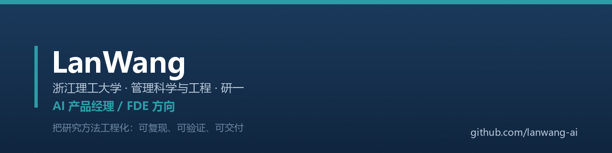

## 你好，我是 LanWang

浙江理工大学 **管理科学与工程** 研一。我做的东西只有一个主题：**让 AI 的输出变得可核查**。
目标岗位：**AI 产品经理 / FDE**。

> 工作方法：把研究方法工程化 —— 可复现、可验证、可交付。

---

## 代表项目

### 🧭 audit_probe · Agent 可信度审计台

不判答案对不对，只判**这句话里的具体信息，在该轮工具执行记录里有没有出现、有没有矛盾**。

- **五态判定**：有证据支持 / 部分支持 / 无证据 / 与证据矛盾 / 不判分，配「冲突优先」五步判定
- **纯规则引擎，零大模型调用**：同一输入同一结果，可复现
- **评测**：双人盲标一致率 62.5%（κ=0.513）；系统与两位人类合计 66.2%（95% CI 55.4–75.7），方向性严重错误 0 条
- **正在做**：把「一对标注者 n=40」升级为「3 标注者 n=150 + Fleiss κ」
- 私有项目，可当面演示

### 📐 deep-ocean-slides · 离线学术风 PPT 工具链

论文 PDF → **可编辑 .pptx** + 单文件 HTML + 排版自检。**不联网、不需要 API key、零成本。**

| 能力 | 说明 |
|---|---|
| 13 个版式契约 | 版式即数据；PPTX 与 HTML 两个渲染器共用同一份 schema |
| 31 条自检规则 | 禁止项 / 越界 / 字号 / 对比度 / 留白 / 图片页上限，`check --strict` 0 错 0 警 |
| 设计令牌 | 颜色与字号单一事实源，`tokens` 一条命令导出全部数值 |
| 论文入口 | `from-paper` 一条命令出初稿，数字全部标注原文页码 |
| 离线修复 | `normalize` 修序列长度 / 表格列宽 / 语气，不改文字、不编内容 |
| Agent 技能 | `skills/deep-ocean-slides/SKILL.md`，agent 读它即可执行全流程 |

→ [仓库](https://github.com/lanwang-ai/deep-ocean-slides) · [设计规范](https://github.com/lanwang-ai/deep-ocean-slides/blob/main/docs/STYLE.md) · [离线写作契约](https://github.com/lanwang-ai/deep-ocean-slides/blob/main/docs/AUTHORING.md)

---

## 技术栈

`Python` `python-pptx` `Pillow` `规则引擎` `设计令牌` `Linter` `Playwright` `LibreOffice 自动化` `实验设计（盲标 / κ 一致性）`

## 现在在做

- 把 audit_probe 的评测从 n=40 扩到 n=150、三标注者，目标是让置信区间从 ±13pp 收到 ±6~7pp
- 维护 deep-ocean-slides：离线优先，不依赖任何模型服务

---

这个仓库的 README 显示在我的 GitHub 主页上 · <a href="https://github.com/lanwang-ai">github.com/lanwang-ai</a>
